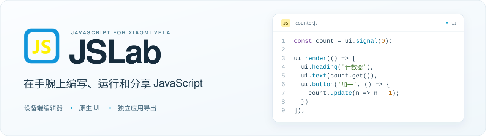
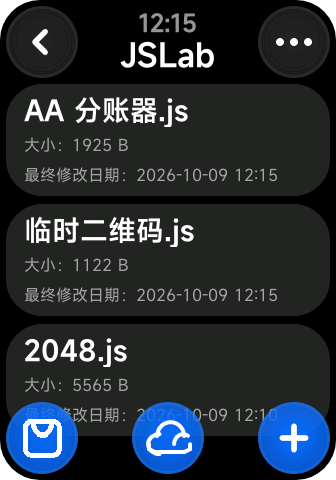
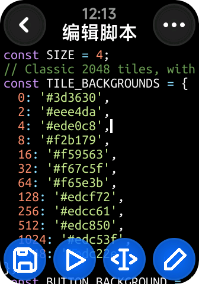
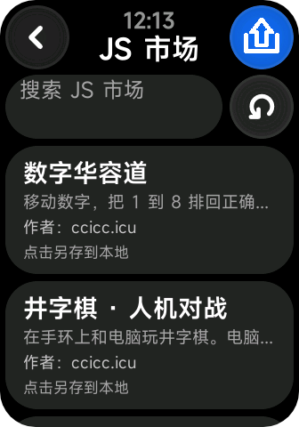

<div align="center">
  <picture>
    <source media="(prefers-color-scheme: dark)" srcset="docs/assets/readme-hero-dark.svg" />
    
  </picture>
  <p>
    <a href="https://ccicc.icu/jslab-cloud/downloads"><strong>下载安装</strong></a> &nbsp;·&nbsp;
    <a href="docs/README.md"><strong>使用文档</strong></a> &nbsp;·&nbsp;
    <a href="examples/README.md">脚本示例</a> &nbsp;·&nbsp;
    <a href="https://ccicc.icu/jslab-cloud/">访问云端</a>
  </p>
  <p>
    <a href="https://github.com/cciccicu/JSLab/actions/workflows/checks.yml"></a>
    &nbsp; <a href="LICENSE"></a>
  </p>
</div>

JSLab 是面向小米 Vela 穿戴设备的开源 JavaScript 开发环境。你可以直接在手环、手表上编辑和运行脚本，也可以通过 Android、AstroBox 或浏览器完成编辑与传输。脚本既能输出日志，也能拥有按钮、布局、图片和画布，适合制作随身工具、交互页面与小游戏。

从使用现成作品到发布自己的应用，JSLab 提供一条完整路径：在 JS 市场发现脚本，在设备上运行和修改，再分享源码，或通过云端导出可独立安装的快应用。

<p align="center">
  <a href="jslab-cloud/assets/jslab-screen-scripts-20261009.png"></a>
  <a href="jslab-cloud/assets/jslab-screen-code-20261009.png"></a>
  <a href="jslab-cloud/assets/jslab-screen-market-20261009.png"></a>
</p>
<p align="center"><sub>设备端界面示例：文件管理、代码编辑与 JS 市场。点击图片查看原图。</sub></p>

## 主要功能

- **设备端代码编辑。** 文件管理、语法高亮、光标定位与代码输入都在设备上完成；编辑后即可运行并查看日志。
- **用 JavaScript 描述界面。** 通过 `ui` 创建文字、按钮、开关、布局、二维码、图片和 Canvas，用状态与事件驱动交互；通过 `script`、`dialog` 和 `system` 使用数据存储、对话框与设备能力。
- **在多个设备之间协作。** Android 同步器与 AstroBox 插件直接管理设备脚本和脚本数据；JSLab Cloud 提供浏览器编辑、云空间与 AI 辅助编写。文件由用户主动上传、下载或传输。
- **分享源码或发布应用。** 将作品发布到 JS 市场，或把脚本与运行引擎一起导出为独立 RPK。独立应用从设备应用列表启动，无需预先安装 JSLab。

## 开始使用

1. **安装设备端。** 在[下载页](https://ccicc.icu/jslab-cloud/downloads)选择与你的设备相符的安装包，按照[安装指南](docs/guide/installation.md)安装。当前提供小米手环 Pro 与 REDMI Watch 5 两种布局，以及完整版、社区版。
2. **运行第一个脚本。** 从 JS 市场下载作品，或者按照[快速上手](docs/guide/getting-started.md)新建一个计数器。已有代码也可以通过[配套端](docs/guide/sync-guide.md)导入。
3. **选择自己的工作方式。** 在手腕上直接修改，使用 Android 或 AstroBox 编辑和同步，或在[云空间](https://ccicc.icu/jslab-cloud/workspace)继续创作。社区版支持选择第三方服务器。

设备端应用免费，本地编辑与运行无需激活云空间。官方云空间、AI 和独立应用导出按服务规则开通或使用额度，详见[云端使用指南](docs/guide/cloud-guide.md)。云端服务源码随仓库提供，可使用 Node.js [独立部署](docs/development/cloud-operations.md)，也保留 ccicc.icu 插件模式。

### 一份脚本，一个交互界面

在 JSLab 中新建 `counter.js`，粘贴以下代码并运行：

```js
const count = ui.signal(0);

ui.render(() => [
  ui.heading('计数器'),
  ui.text('当前次数：' + count.get()),
  ui.button('加一', () => {
    count.update(value => value + 1);
  }),
  ui.button('清零', () => count.set(0))
]);
```

`ui` 由 JSLab 的脚本环境提供。按钮回调改变状态后，界面会自动更新。继续阅读[制作交互界面](docs/guide/ui-api.md)、[脚本运行接口](docs/reference/runtime-api.md)，或从[示例目录](examples/README.md)开始修改。

## 实现概览

JSLab 在 Vela 的 JavaScript 引擎之上实现脚本环境、编辑器和应用导出流程。三个核心部分分别处理执行与交互、设备端编辑，以及应用分发：

| 模块 | 实现方式 |
| --- | --- |
| **脚本运行器与 UI** | 为每次运行建立会话、注入脚本接口，将 UI 描述编译为原生组件布局，通过状态更新、测量缓存和差异提交减少重复工作。 |
| **设备端编辑器** | 维护文字与行位置模型，按修改范围重新进行词法分析，沿跨行状态传播高亮结果，并尽量复用原有显示对象。 |
| **独立快应用导出** | 发布引擎时预编译设备模板；导出时在内存中装配源码、应用信息与资源，重新生成摘要并签名。每次导出无需启动完整编译工具链。 |

[了解 JSLab 原理](docs/guide/how-jslab-works.md)进一步说明数据流、缓存边界、模板同步与签名过程，并提供源码阅读入口。

## 从源码开始

本仓库包含多个独立交付项目。先安装 Git 与 Node.js 24，选择需要开发的项目；无需一次安装所有平台的工具链。下面以设备端的手环 Pro 调试构建为例：

```sh
git clone https://github.com/cciccicu/JSLab.git
cd JSLab
node scripts/check-repository.cjs

cd vela-quickapp
npm ci
npm run check:contract
npm run check:devices
npm run build:bandpro
```

安装包输出到 `vela-quickapp/release-archive/`。REDMI Watch 5 调试构建使用 `npm run build:watch5`；正式版、社区版与签名配置见[设备构建说明](docs/development/device-layouts.md)。

## 仓库结构

六个子项目在根目录并列，各自维护依赖、构建入口和发布产物；公共文档、示例与接口定义集中存放。

```text
JSLab/
├── vela-quickapp/         # 设备端：编辑器、运行器与原生 UI
├── android-sync/          # Android 编辑器与设备同步器
├── astrobox-plugin-sync/  # AstroBox v2 同步插件
├── jslab-cloud/           # 独立云服务与宿主桥接：云空间、市场、AI、打包
├── vela-rpk-template/     # 独立 RPK 的预编译引擎模板
├── vela-luawatchface/     # JSLab Helper 辅助表盘
├── docs/                  # 使用指南、开发文档与第三方许可说明
├── examples/              # 示例脚本、市场作品与人工验收脚本
├── types/                 # 脚本 API 类型声明与共享运行契约
├── scripts/               # 仓库检查与本地缓存清理
├── .github/               # CI、贡献指南与安全报告说明
├── .vscode/               # 可共享的 VS Code 多项目工作区
├── README.md              # 项目首页
├── AGENTS.md              # AI 开发协作约定
└── LICENSE                # 项目代码许可证
```

子项目入口：[设备端](vela-quickapp/README.md) · [Android](android-sync/README.md) · [AstroBox](astrobox-plugin-sync/README.md) · [云端](jslab-cloud/README.md) · [RPK 模板](vela-rpk-template/README.md) · [Helper 表盘](vela-luawatchface/README.md)。各项目 README 提供工具链要求和最短构建步骤，依赖版本由相应锁文件固定。

[docs](docs/README.md) 是文档总入口；[types/runtime-contract.json](types/runtime-contract.json) 统一维护公开方法、日志与对话框参数和 UI 性能建议。使用 VS Code 时，可直接打开[多项目工作区](.vscode/JSLab.code-workspace)。根目录的 `.editorconfig`、`.gitattributes` 和 `.gitignore` 分别管理编辑格式、Git 文件处理和忽略规则。

个人工具、字体预览和历史安装包归档集中在已忽略的 `.local-tools/`，各子项目的依赖及构建输出按自身工具链管理。目录维护方式见[仓库维护说明](docs/development/repository.md)。

云端服务直接使用仓库内的预编译模板。修改共享运行引擎后，同步并重建两个设备模板，将模板 ZIP 与元数据一起提交。

## 反馈与贡献

使用问题可先查阅[常见问题](docs/guide/troubleshooting.md)，也可以在[米坛社区](https://www.bandbbs.cn/resources/3440/)交流。报告缺陷或提出改进建议，请提交 [GitHub Issue](https://github.com/cciccicu/JSLab/issues)，附上组件版本、设备型号、复现步骤和必要日志。安全问题请遵循[安全报告说明](.github/SECURITY.md)。

欢迎通过 Pull Request 改进代码、文档与示例。提交前阅读[贡献指南](.github/CONTRIBUTING.md)，执行仓库检查与受影响项目的现有检查；涉及脚本接口或云端协议时，保留旧脚本和旧客户端的兼容性。[架构说明](docs/development/architecture.md)介绍模块边界，[发布流程](docs/development/releasing.md)介绍各端的交付要求。

## 许可证与致谢

项目采用 [GNU GPL v3](LICENSE)。第三方组件保留各自许可，完整来源与分发说明见[第三方组件与工具](docs/third-party/README.md)。

设备端内置字体 **JSLab Wrist Mono** 由 Sarasa Mono SC 的文字、标点与 Noto Emoji 的单色图标制作，按 OFL-1.1 分发；[字体文档](docs/third-party/editor-font.md)提供来源、字符覆盖与可复现构建方法。字体许可独立于项目代码许可。

感谢 Vela 与 AIoT 工具链、AstroBox、输入法组件、Sora Editor、TextMate 及字体上游项目。官方穿戴 SDK 与表盘编译器按各自条件获取，准备方式见对应开发文档。
