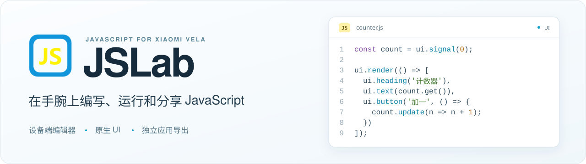
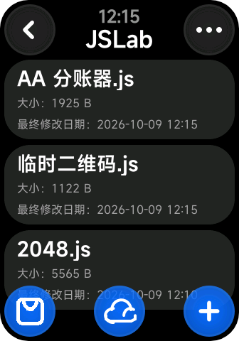
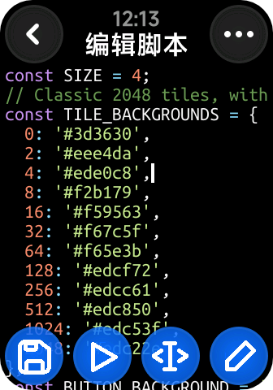
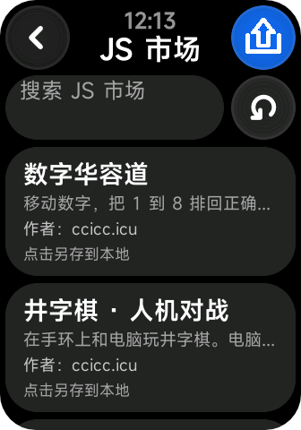

<div align="center">
  <picture>
    <source media="(prefers-color-scheme: dark)" srcset="assets/readme-hero-dark.svg" />
    
  </picture>
  <p>
    <a href="../README.md"><strong>中文首页</strong></a> &nbsp;·&nbsp;
    <a href="https://ccicc.icu/jslab-cloud/"><strong>Website</strong></a> &nbsp;·&nbsp;
    <a href="https://ccicc.icu/jslab-cloud/downloads"><strong>Downloads</strong></a> &nbsp;·&nbsp;
    <a href="https://ccicc.icu/jslab-cloud/workspace/market"><strong>Script Market</strong></a> &nbsp;·&nbsp;
    <a href="README.md">Docs (ZH)</a> &nbsp;·&nbsp;
    <a href="../examples/README.md">Examples</a>
  </p>
  <p>
    <a href="https://github.com/cciccicu/JSLab/actions/workflows/checks.yml"></a>
    &nbsp; <a href="../LICENSE"></a>
  </p>
</div>

**JSLab** is a full-stack, open-source (**GPL-3.0**) JavaScript development platform for **Xiaomi Vela** smartbands and smartwatches (Xiaomi Smart Band Pro series and REDMI Watch series).

Users can write, run, and share interactive utilities and mini-games directly on their wrist, sync scripts and data through companion tools on Android or AstroBox, collaborate in a self-hostable cloud workspace with AI-assisted coding, publish creations to the public Script Market, or package scripts into standalone installable `.rpk` QuickApps.

<p align="center">
  <a href="../jslab-cloud/assets/jslab-screen-scripts-20261009.png"></a>
  <a href="../jslab-cloud/assets/jslab-screen-code-20261009.png"></a>
  <a href="../jslab-cloud/assets/jslab-screen-market-20261009.png"></a>
</p>
<p align="center"><sub>On-device screenshots: local script library, syntax-highlighted editor, and JS Script Market.</sub></p>

## Core Capabilities

- **On-device Editor & Runtime**: Manage local files, edit JavaScript with incremental lexical syntax highlighting, execute scripts, and inspect runtime logs directly on the wearable.
- **Declarative Native UI & Device APIs**: Build interactive apps using `ui` (headings, text, buttons, toggles, layouts, QR codes, images, and Canvas) driven by reactive signals, alongside `script`, `dialog`, and `system` APIs for storage, dialogs, HTTP, files, sensors, and device capabilities.
- **Multi-Device Companion Ecosystem**: Edit and transfer scripts and script storage via the native Android Sync app, the AstroBox v2 WASI plugin, or the web-based JSLab Cloud workspace (with AI coding assistance and third-party server support in Community Edition).
- **Script Market & Standalone RPK Export**: Publish scripts to the public [Script Market](https://ccicc.icu/jslab-cloud/workspace/market), or export a script together with the precompiled Vela runtime engine as an independently installable `.rpk` package.

### Example: Interactive Counter Script

```js
const count = ui.signal(0);

ui.render(() => [
  ui.heading('Counter'),
  ui.text('Count: ' + count.get()),
  ui.button('+1', () => count.update(value => value + 1)),
  ui.button('Reset', () => count.set(0))
]);
```

## Distribution & Community

Wearable users primarily install Xiaomi Vela QuickApps through dedicated wearable ecosystems rather than GitHub Releases, so GitHub Stars alone do not reflect real-world adoption.

### Public Channels

- **Official Website & Cloud Workspace**: [ccicc.icu/jslab-cloud](https://ccicc.icu/jslab-cloud/)
- **Direct Downloads (RPK / APK)**: [ccicc.icu/jslab-cloud/downloads](https://ccicc.icu/jslab-cloud/downloads)
- **Public Script Market**: [ccicc.icu/jslab-cloud/workspace/market](https://ccicc.icu/jslab-cloud/workspace/market)
- **AstroBox Official Source**: [JSLab Community Edition on AstroBox](https://abox.run/open?source=resv2&id=icu.ccicc.jslab&provider=OfficialV2) ([Release Repo](https://github.com/cciccicu/JSLab_AstroBox_Release) · [Sync Plugin Repo](https://github.com/cciccicu/JSLab-AstroBox-Plugin-Release))
- **BandBBS (米坛社区)**: [Xiaomi Smart Band Pro](https://www.bandbbs.cn/resources/8607/) · [REDMI Watch](https://www.bandbbs.cn/resources/8733/) · [Community Discussion](https://www.bandbbs.cn/resources/3440/)

### Ecosystem Snapshot (as of 2026-11-20)

- **Confirmed external downloads**: **5,789+** across three tracked channels — AstroBox (**2,337**), BandBBS (**730**), and Watchface Custom Tool (**722** on the current listing plus **2,000+** confirmed prior to a relisting). Pre-redesign AstroBox downloads (~2,000 estimated), direct website downloads, and GitHub Releases are excluded. Counts represent download events rather than deduplicated unique users.
- **Public Script Market**: **75** published community scripts from **24** distinct author accounts ([browse live](https://ccicc.icu/jslab-cloud/workspace/market)).
- **User Community**: **250+** active members in the user group.

## Security Architecture & Automated Review

Because JSLab executes community-authored JavaScript on wearable devices and operates a multi-client cloud backend with package signing, security boundaries are a core part of the architecture:

| Surface | Design & Current Controls |
| --- | --- |
| **On-device Script Execution** | Runs community JavaScript on Vela with per-session isolation, controlled injection of `ui` / `script` / `dialog` / `system` APIs, and explicit runtime contracts ([`types/runtime-contract.json`](../types/runtime-contract.json)). |
| **Cloud Auth & Device Pairing** | Separates QuickApp device APIs ([`jslab-cloud/lib/device-api.js`](../jslab-cloud/lib/device-api.js)) from browser Web APIs ([`jslab-cloud/lib/browser-api.js`](../jslab-cloud/lib/browser-api.js)), managing account auth, device pairing tokens, and cloud file access. |
| **In-Memory RPK Packaging & Signing** | Assembles user scripts with precompiled Vela templates in memory, recomputes digests, and signs standalone `.rpk` archives without invoking a full build toolchain or writing temporary user-script files ([`jslab-cloud/lib/rpk-builder.js`](../jslab-cloud/lib/rpk-builder.js)). |
| **LLM Automated Market Moderation** | Community submissions undergo automated LLM security review ([`jslab-cloud/lib/market-service.js`](../jslab-cloud/lib/market-service.js)) checking for malicious behavior, credential theft, destructive actions, and description mismatches, persisting decisions, rationales, and content hashes. When an update is rejected, the market retains the previously approved version. |

To report a vulnerability privately, please follow [`.github/SECURITY.md`](../.github/SECURITY.md).

## Repository Structure

This monorepo contains **six independently deliverable subprojects** plus shared documentation, type contracts, and examples. Cloud services are fully open-source and support standalone Node.js self-hosting.

| Directory | Description |
| --- | --- |
| [`vela-quickapp/`](../vela-quickapp/README.md) | Wearable QuickApp: on-device editor, JS runtime, and declarative native UI |
| [`android-sync/`](../android-sync/README.md) | Native Android script editor and device sync companion |
| [`astrobox-plugin-sync/`](../astrobox-plugin-sync/README.md) | AstroBox v2 WASI sync plugin |
| [`jslab-cloud/`](../jslab-cloud/README.md) | Standalone Node.js cloud server & plugin bridge: workspace, market, LLM review, AI coding, RPK export |
| [`vela-rpk-template/`](../vela-rpk-template/README.md) | Precompiled Vela runtime templates used for standalone RPK packaging |
| [`vela-luawatchface/`](../vela-luawatchface/README.md) | JSLab Helper Lua watchface |
| [`docs/`](README.md) · [`examples/`](../examples/README.md) · [`types/`](../types/runtime-contract.json) | User/developer guides, example scripts, TypeScript definitions, and shared runtime contract |

## Quick Build Check

Requires Git and Node.js 24. Each subproject manages its own toolchain independently:

```sh
git clone https://github.com/cciccicu/JSLab.git
cd JSLab
node scripts/check-repository.cjs

cd vela-quickapp
npm ci
npm run check:contract
npm run check:devices
npm run build:bandpro
```

## Contributing & License

- Contributions are welcome via [GitHub Issues](https://github.com/cciccicu/JSLab/issues) and Pull Requests. See [`.github/CONTRIBUTING.md`](../.github/CONTRIBUTING.md) and [`docs/development/architecture.md`](development/architecture.md).
- Licensed under [GNU GPL v3](../LICENSE). Third-party components and licenses (including the bundled **JSLab Wrist Mono** font under OFL-1.1) are documented in [`docs/third-party/README.md`](third-party/README.md).
