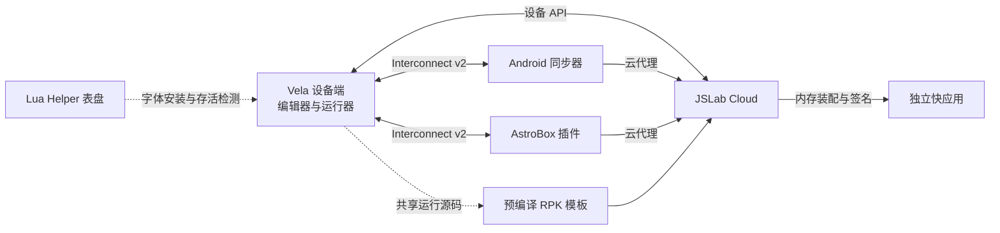

# 项目架构与职责边界

JSLab 由设备应用、两个配套端、云端插件、独立应用模板和辅助表盘组成。它们共享协议与部分运行源码，各自维护构建系统和交付产物。

## 六个交付项目

| 项目 | 所有权 | 产物 |
| --- | --- | --- |
| `vela-quickapp/` | 设备 UI、脚本编辑与执行、本地持久化、设备云请求 | RPK |
| `android-sync/` | 原生手机编辑器、SDK 适配、草稿和同步 | APK |
| `astrobox-plugin-sync/` | AstroBox Host UI、Interconnect 与云代理 | WASI Component / ABP |
| `ccicc-plugin-cloud/` | 云文件、用户服务、市场、AI、文档与导出 | 宿主插件 ZIP |
| `vela-rpk-template/` | 共享引擎同步、设备模板编译与元数据 | 两套固定模板 ZIP |
| `vela-luawatchface/` | 独立 Lua 资源、动画与 Helper 服务 | FACE |

配套端通过协议操作文件，不读取设备私有目录。脚本在设备执行；云端保存和分发内容，打包阶段只装配资源。Lua 表盘使用独立运行时，不混入快应用或 AstroBox 的构建产物。

## 设备内的模块边界

运行页持有本次源码快照、日志与 UI 会话。`uiRuntime.js` 管状态调度和回调，`uiLayout.js` 计算布局，`uiPublisher.js` 写入页面数据。脚本接口由 `scriptRuntimeApi.js` 汇总；持久化由 `scriptData.js` 负责。

编辑器把源码与行模型、高亮缓存、响应式显示数据分开。页面隐藏、退出、重新加载由原生生命周期协调。跨页面对话框状态只由 `app.ux` 持有，各页通过 `$app.$def` 调用，避免独立页面打包造成多个状态实例。

云管理模块与注入脚本的系统 API 分离。详细模块表见[公共模块说明](quickapp-modules.md)，关键算法见[运行原理](../guide/how-jslab-works.md)。

## 共享契约与生成流程

| 来源 | 使用者 / 生成物 |
| --- | --- |
| `types/runtime-contract.json` | 设备运行契约常量、云端契约 JSON、模板一致性检查 |
| `vela-quickapp/src/utils/runtime/` 等运行源码 | `vela-rpk-template/` 的同步副本与预编译资产 |
| `docs/guide/`、`types/`、设备帮助一级目录 | 云插件 `generated/docs/` 中的帮助资源 |
| 同步协议与 `astrobox-plugin-sync/test-data/` | Android、AstroBox 和 Vela 兼容回放 |

生成目录中不人工修正文档。模板 ZIP 是有意提交的编译资产，云端部署无需整个工具链；其他本地产物遵循忽略规则。

## 服务端边界

云插件通过生命周期函数注册页面与接口。Web API 使用会话和 CSRF，设备 API 使用 Bearer 令牌；业务服务可以复用，路由和鉴权不能混用。持久化初始化在 install 与 boot 中均可幂等执行。

市场内容为发布快照，云空间为当前文件集合。编辑、审核、额度和失败恢复属于服务端业务模块，页面只负责交互和呈现。更多配置见[云端开发](cloud.md)和[部署说明](cloud-operations.md)。

## 兼容与验证

旧脚本保留 API、参数、返回值和行为，旧设备保留接口路径与鉴权语义。新能力通过可选字段、独立入口或版本协商扩展。Pro 与 RW 尽可能共用逻辑，只在构建期选择几何参数与样式。

验证项目包括主机逻辑、静态布局、编译产物和目标设备交互。各组件按对应项目的发布流程交付。
