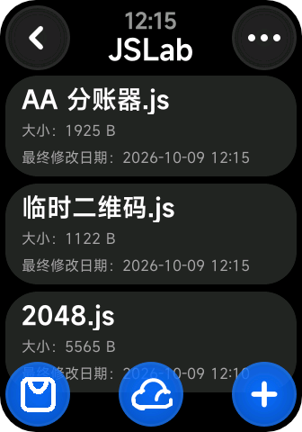

# 管理脚本与使用编辑器

> 最低支持版本：本页的文件管理、编辑、运行、字号、高亮与清除脚本记录功能支持 JSLab 2.0.0 及以上。内置 Emoji 图标需要 2.0.6；大文件限制见下文。

本页介绍已经打开 JSLab 后的日常操作。第一次使用时，可以先按 [入门教程](getting-started.md) 建立一个测试脚本。

## 认识首页的两种状态

首页列出当前设备上的本地脚本，并显示文件大小和修改时间。点击文件会选中它，再点同一文件会取消选择。

*界面示例；文件名和内容以你的设备为准。*

| 当前状态 | 底部按钮，从左到右 |
| --- | --- |
| 没有选中文件 | JS 市场、云空间、新建脚本 |
| 已选中文件 | 运行、上传到云空间、编辑、删除 |

右上角的更多按钮进入设置。设置里可以找到编辑器设置、传输方式、云账户、帮助、关于和捐助入口。

## 新建、打开和编辑

取消源码固定 48 KiB 上限需要 JSLab 2.0.4，实际可处理大小仍受设备内存和性能影响。

1. 取消当前文件选择，点击右下角的新建按钮。
2. 输入容易辨认的文件名，选择模板。没有 `.js` 后缀时会自动补上。
3. 创建后进入编辑器，点击代码区域打开输入法。
4. 使用编辑器的光标控制调整插入位置。按返回会先收起键盘或光标控制，再处理是否退出编辑器。

已有文件需要修改时，在首页选中文件，再点击编辑按钮。直接点击运行按钮会运行已保存的文件。

## 保存与运行分别做什么

收起键盘后，编辑器底部提供保存和运行按钮。

- **保存**把当前代码写入本地文件，下次打开时仍可读取。
- **运行**执行编辑器当前的内容，包含尚未保存的修改，但不会替你保存文件。

离开编辑器时，如果内容有变化，会询问是否保存。选择“不保存”会放弃这次修改；选择“继续编辑”会回到编辑器。

脚本显示界面后，按返回可查看日志；轻点日志内容可恢复界面。从日志页再返回，才会离开这次运行。重载按钮会从头执行本次打开的代码，普通变量随之重新初始化。

## 另存为、重命名和删除

编辑器右上角菜单的“另存为”可以把当前代码保存为另一个文件。试验较大的修改前，先用它保留一个副本。

需要重命名时，可以使用 Android 同步器或 AstroBox 插件。通过 JSLab 的文件管理功能重命名，会同时迁移该脚本的数据和配置；另存为新的文件名则作为另一个脚本使用。

在首页选中文件后点击删除，确认后直接删除源码及对应的数据和配置。需要保留时先按 [手机与 AstroBox 同步](sync-guide.md)导出备份。

## 调整字号和语法高亮

进入“设置 > 编辑器设置”，可以调整编辑器字号。进入“语法高亮”后，可以开关彩色代码、设置字符和行数阈值，并选择配色。

这些阈值用于控制高亮处理的范围，避免较大文件的显示过慢，**不限制脚本能保存多少代码**。当前字体更换入口显示“即将上线”，尚不能通过这个入口安装字体。

打开超过 48 KiB 的脚本时，选择大脚本提醒中的“继续编辑”即可进入编辑器。大文件也可以在手机或电脑上编辑，再传回设备运行。

## 清除脚本记录与偏好

编辑器右上角菜单有“清除数据”和“清除配置”。它们分别清除当前脚本通过 `script.data` 和 `script.config` 保存的内容，确认后生效，不改写源码。

例如计数器记住了上次次数，可以清除数据重新开始；恢复脚本设置时，可以清除配置。脚本通过文件接口写入的文件另行管理。

## 同步云文件与本地文件

编辑器保存的是本地文件。要在网页看到修改，需要从首页主动上传；网页编辑完成后，也要在设备云空间主动下载。

如果遇到保存、联网或运行异常，请查看 [常见问题与排查](troubleshooting.md)。
